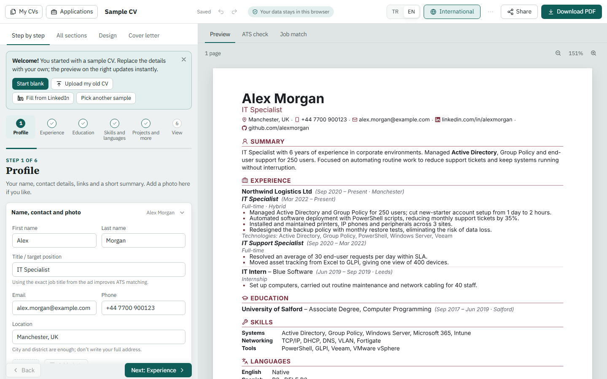

<div align="center">

# CV Builder

**A free, private, ATS-friendly CV builder that runs entirely in the browser.**

No sign-up, no watermark, no server. Your data never leaves your device.

[Live demo](https://cv-builder-eight-snowy.vercel.app/) · [Report a bug](https://github.com/erencagliz/cv-builder/issues/new?template=bug_report.yml) · [Request a feature](https://github.com/erencagliz/cv-builder/issues/new?template=feature_request.yml)

[](https://github.com/erencagliz/cv-builder/actions/workflows/ci.yml)
[](LICENSE)




</div>

## Why

Most CV builders either charge you at the download step, add a watermark, or produce designer PDFs that applicant tracking systems (ATS) cannot read. CV Builder takes the opposite approach:

- **Every PDF is real, tagged text.** Documents are typeset with [Typst](https://typst.app) compiled to WebAssembly, so the text layer is exactly what an ATS extracts. Ligatures and hyphenation are disabled so keywords are never split, and decorative icons are marked as PDF artifacts.
- **The ATS check reads your actual PDF.** Instead of guessing from form fields, the report renders the PDF, extracts it again with pdf.js, and verifies that your name, contact details, headings, dates and skills survive the round trip.
- **Local-first by design.** CVs are stored in IndexedDB. Share links encode the CV in the URL fragment, which browsers never send to a server.

## Features

| Area | What you get |
| --- | --- |
| Content | Every common section (experience with promotion grouping, education, skills, languages with exam scores, certificates, projects, courses, volunteering, awards, publications, talks, memberships, references) plus unlimited custom sections. 20 link types that expand a username into a full URL. Region-specific personal fields such as date of birth, nationality, military service and driving licence. |
| Editing | Step-by-step wizard or a single list of all sections, drag-and-drop ordering, hide/rename sections, undo/redo, autosave, version history, multiple CVs, duplication, keyboard shortcuts. |
| Design | 7 templates, 20 fonts with full Latin Extended coverage, colour presets with contrast warnings, independent font sizes and spacing, A4 and Letter, photo options, heading and date styles. A "fit to one page" action finds the smallest change that fits, without going below readability limits. |
| ATS report | A 100-point score across parsing, impact, completeness, keywords and layout. Bullet-level feedback on weak verbs, passive voice, missing metrics and vague wording, with suggestions for stronger verbs. |
| Job match | Paste a job posting to see which terms from a curated dictionary of roles and technologies are present or missing, add missing ones to your skills in one click, and check requirements such as years of experience, licences and languages. |
| Cover letters | Same design as the CV, with starter templates filled from your title, experience and skills. |
| Import | Existing CVs from PDF, Word or plain text (including two-column layouts), LinkedIn "Save to PDF" exports, JSON Resume and native backups. |
| Export | PDF, Word (.docx with real heading styles and lists), plain text, JSON Resume, full backup. |
| Sharing | Serverless share links and QR codes, with a read-only viewer that can copy the CV into your own collection. |
| Tracking | A lightweight job application tracker with statuses, follow-up dates and CSV export. |
| Platform | English and Turkish interface with localized URLs, dark mode, responsive layout, installable PWA that works offline. |

## Tech stack

| Concern | Choice |
| --- | --- |
| UI | [React 19](https://react.dev), TypeScript 5.8 (strict) |
| Build | [Vite 6](https://vite.dev) |
| State | [Zustand](https://zustand.docs.pmnd.rs) with [Immer](https://immerjs.github.io/immer/) for immutable updates and snapshot-based undo/redo |
| Persistence | IndexedDB via [Dexie](https://dexie.org) |
| Typesetting | [Typst](https://typst.app) through [typst.ts](https://github.com/Myriad-Dreamin/typst.ts) (WebAssembly, in a Web Worker) |
| PDF parsing | [pdf.js](https://mozilla.github.io/pdf.js/) |
| Word export / import | [docx](https://docx.js.org), [JSZip](https://stuk.github.io/jszip/) |
| Drag and drop | [dnd kit](https://dndkit.com) |
| Testing | [Vitest](https://vitest.dev), [Playwright](https://playwright.dev), fake-indexeddb |
| Quality | ESLint (typescript-eslint, react-hooks), GitHub Actions |

## How it works

```
 Editor (React)                      Render worker                         Output
┌──────────────┐  CV JSON   ┌──────────────────────────────┐
│ Zustand store├──────────► │ buildModel()  → render model │
│ (Immer)      │            │ Typst WASM    → cv.typ       ├──► SVG pages (live preview)
└──────┬───────┘            │ embedded fonts               ├──► Tagged PDF (download)
       │ autosave           └──────────────┬───────────────┘
       ▼                                   │ PDF bytes
  IndexedDB (Dexie)                        ▼
                                 pdf.js text extraction ──► ATS report, job match
```

1. The editor keeps the CV as a typed JSON document (`src/model/types.ts`). Every change goes through Immer, so each edit produces a structurally shared snapshot. Snapshots form the undo/redo history (consecutive keystrokes in one field are grouped), and changes are saved to IndexedDB after a short debounce.
2. `buildModel()` turns the CV into a presentation-neutral render model: localized section titles and dates, resolved links, rich text segments.
3. A Web Worker runs the Typst compiler. User text is passed as JSON data and never interpreted as Typst code, so input cannot break or inject into the template.
4. The same model feeds the live SVG preview, PDF and DOCX export and the plain-text view, so all outputs stay in sync.
5. The ATS report extracts text from the generated PDF and scores what a parser would actually see.

## Getting started

Requirements: Node.js 20 or newer.

```bash
git clone https://github.com/erencagliz/cv-builder.git
cd cv-builder
npm install
npm run dev
```

The app runs at http://localhost:5173.

### Scripts

| Command | Description |
| --- | --- |
| `npm run dev` | Start the development server |
| `npm run build` | Type-check, build to `dist/` and generate localized HTML, `robots.txt` and `sitemap.xml` |
| `npm run preview` | Serve the production build |
| `npm run lint` | ESLint with zero warnings allowed |
| `npm run typecheck` | TypeScript project check |
| `npm test` | Unit and integration tests (Vitest) |
| `npm run test:coverage` | Tests with a coverage report in `coverage/` |
| `npm run test:e2e` | Build and run browser tests (Playwright) |
| `npm run check` | Lint, type-check and test in one go |

Run `npx playwright install chromium` once before the first end-to-end run.

## Testing

The suite is split by cost and scope:

- **Unit tests** (`tests/unit`) cover routing, language detection, the translation layer, the data model and its migrations, link and phone formatting, date formatting, share-link encoding, ATS scoring rules, job-posting parsing and IndexedDB storage and backups.
- **Integration tests** (`tests/integration`) run the real Typst WebAssembly compiler in Node. They render every template with every font and assert that Turkish characters survive PDF text extraction, check the ATS report end to end against sample CVs, and measure import accuracy by rendering CVs to PDF, DOCX and plain text and parsing them back.
- **End-to-end tests** (`tests/e2e`) drive the production build in Chromium: language detection and switching, localized and legacy URLs, editing and autosave, undo, templates, PDF and Word downloads, the ATS and job-match panels, share links and the viewer, importing old CVs, backups and the application tracker. Every test fails on uncaught page errors.

## Internationalization

The interface supports English (default) and Turkish. English URLs have no prefix, Turkish URLs are prefixed and use Turkish slugs:

| Page | English | Turkish |
| --- | --- | --- |
| Home | `/` | `/tr/` |
| Editor | `/edit/:id` | `/tr/duzenle/:id` |
| Shared CV | `/view#…` | `/tr/goruntule#…` |

The language is taken from the URL, then from the saved preference, then from the browser, falling back to English. Unprefixed Turkish links from earlier versions are redirected to their canonical form. The build emits a separate `tr/index.html` with Turkish metadata and `hreflang` alternates.

Interface strings are authored once in the components, and `src/i18n/en.ts` maps them to English. A DOM translation layer applies the dictionary to text nodes and accessible attributes, so new UI text is picked up automatically. The end-to-end suite fails if any interface text is left untranslated. CV content language is chosen per CV and is independent of the interface language.

## Project structure

```
src/
  ats/         ATS scoring, keyword extraction, writing hints, job-posting parsing
  content/     Sample CVs for 12 professions and cover-letter starters
  editor/      Editor screens: wizard, sections, design, insights, CV manager
  export/      Word export
  i18n/        Language detection and the translation layer
  import/      PDF, Word, text and LinkedIn importers
  model/       CV types, defaults and migrations, templates, file formats
  render/      Render model, Typst template, WebAssembly engine and worker
  share/       Share links and the read-only viewer
  store/       IndexedDB persistence, backups, editor state
  ui/          Shared components, routing, theming
tests/
  unit/  integration/  e2e/  fixtures/  helpers/
scripts/       Build helpers for fonts, icons and post-build output
```

## Deployment

`dist/` is a static site; no server or database is needed. Single-page routing rules are included for common hosts:

- **Vercel:** `vercel.json`
- **Netlify and Cloudflare Pages:** `public/_redirects` and `public/_headers`
- **GitHub Pages:** the build writes a `404.html` fallback

Set `SITE_URL` (for example `https://cv.example.com`) at build time to generate canonical URLs, `hreflang` links and a sitemap. On Vercel this is derived automatically.

The Typst compiler is about 28 MB (around 11 MB compressed). It is downloaded once and then served from the browser cache, so make sure your host serves `.wasm` as `application/wasm` with compression enabled.

Before deploying your own instance, set the product name and contact address in `src/config.ts`.

## Contributing

Contributions are welcome. Please read [CONTRIBUTING.md](CONTRIBUTING.md) for the development workflow and [SECURITY.md](SECURITY.md) for reporting vulnerabilities.

## License

The source code is released under the [MIT License](LICENSE).

Bundled third-party assets keep their own licenses:

- Fonts in `public/fonts/` come from Google Fonts under the SIL Open Font License 1.1 or Apache License 2.0, subset to Latin and Latin Extended.
- Icons in `src/render/icons.json` are generated from [Lucide](https://lucide.dev) (ISC) and [Simple Icons](https://simpleicons.org) (CC0). Brand logos are used only to identify the corresponding profile links.
